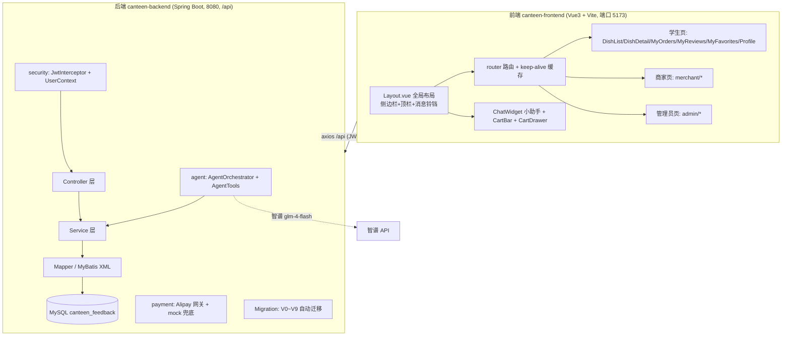

# 校园食堂菜品反馈评价系统 · 项目交接手册

> 本手册写给**接手的下一位开发者**（同样使用 WorkBuddy）。目标是让你在最短时间内了解架构、约定、以及上一任踩过的坑，避免重走弯路。
> 建议先花 10 分钟通读一遍，再动手改代码。

---

## 0. 一句话了解项目

一个**校园食堂「点餐 + 评价 + 反馈」一体化系统**，三类角色共用一套前后端，另外内置一个 **AI 食堂小助手**（Agent 工具调用 + 本地规则引擎兜底）。

---

## 1. 项目定位与三类角色

| 角色 | 能做什么 |
|------|---------|
| **学生** | 浏览菜品/档口、加购、下单支付、评价（需先下单）、收藏、留言、点赞/回复他人评价、收消息通知 |
| **商家** | 档口菜品管理、接单、销售看板/经营分析、回复学生评价、给管理员留言 |
| **管理员** | 轮播广告、商家（档口）管理、评价审核、留言/公告/订单/商家留言/用户/客服知识库/问答记录 |

---

## 2. 技术栈

- **后端**：Spring Boot 3.5.3 + MyBatis-Plus + MySQL 8（库名 `canteen_feedback`）+ JWT；API 统一前缀 `/api`
- **前端**：Vue 3（`<script setup>`）+ Vite + Element Plus + Pinia + ECharts
- **数据库迁移**：`canteen-backend/src/main/resources/db/migration/V*.sql`，后端启动时由 `DatabaseMigrator` 自动执行「没跑过的」，**不要手动改表**
- **环境**：JDK 17+（本机用 23 + `--release 17`）、Maven 3.9.9、Node 22、MySQL 8.0.43（root/123456）

---

## 3. 架构总览（地图）



**请求链路**：前端 `api/*.js` → axios（`/api` 前缀，携带 JWT）→ 后端 `Controller` → `Service` → `Mapper`（MyBatis-Plus / XML）→ MySQL。
**权限**：`JwtInterceptor` 只做「登录鉴权」（解析 token 填 `UserContext`），**角色校验在各接口内部**（`UserContext.isAdmin()` / `requireMerchant()`），前端 `router.beforeEach` 用 `meta.admin`/`meta.merchant` 做路由隔离。

---

## 4. 目录结构

```
canteen-feedback/
├── canteen-backend/               # Spring Boot 后端
│   └── src/main/java/com/qmz/canteen/
│       ├── agent/                 # AI 助手（AgentOrchestrator、AgentTools）
│       ├── common/                # Result/ResultCode/BusinessException/全局异常处理
│       ├── config/                # SecurityConfig、DatabaseMigrator 等
│       ├── controller/            # REST 接口
│       ├── dto/  entity/  vo/     # 请求体 / 实体 / 返回体
│       ├── mapper/                # MyBatis-Plus Mapper + XML(在 resources/mapper/)
│       ├── payment/               # 支付宝网关 + mock 通道
│       ├── security/              # JWT、UserContext、拦截器
│       ├── service/ (+impl/)      # 业务逻辑
│       └── task/                  # 定时任务
│   └── src/main/resources/
│       ├── application.yml        # 端口/数据源/agent 配置
│       ├── mapper/*.xml           # SQL（Dish/Stall/Stats/DishReview 等）
│       └── db/migration/V*.sql    # 自动迁移脚本
├── canteen-frontend/              # Vue3 前端
│   └── src/
│       ├── api/                   # 接口封装（request.js 统一 axios 拦截）
│       ├── components/            # DishCard/BannerCarousel/ChatWidget/cart/chat...
│       ├── views/                 # 页面（学生根目录 / merchant/ / admin/）
│       ├── router/  store/  styles/
│       └── public/                # 静态资源：dishes/、ui/logo、ui/stall、ui/avatars、ui/assistant
├── db/                            # schema.sql / init-data.sql / full-setup.sql（初始建库脚本）
├── scripts/                       # 数据生成等工具脚本
└── .workbuddy/memory/             # 开发过程日志（含历轮踩坑，可继续翻阅）
```

**静态资源约定**：所有图片放 `canteen-frontend/public/`，路径即 URL（如 `/dishes/1.jpg`、`/ui/logo/stall-1.webp`、`/ui/avatars/10004.jpg`）。

---

## 5. 怎么跑起来（最重要，先看这里）

### 5.1 后端（8080）

```bash
cd canteen-backend
env -u SERVER__PORT -u SERVER_PORT mvn spring-boot:run
```

> ⚠️ **必须带 `env -u SERVER__PORT -u SERVER_PORT` 前缀**。
> WorkBuddy 的终端环境里有 `SERVER__PORT=59556`，Spring 的宽松绑定会把它当成 `server.port` 覆盖 yml 的 8080，导致端口冲突起不来。这是本机最常踩的坑。

### 5.2 前端（5173，Vite 热更新）

```bash
cd canteen-frontend
npm run dev
```

### 5.3 验证

- 后端启动成功：控制台打印 Tomcat 8080，约 2s。
- 前端：浏览器开 `http://localhost:5173`，登录即可。

---

## 6. 测试账号

| 角色 | 账号 | 密码 |
|------|------|------|
| 学生 | `student01` ~ `student60` | `123456`（id 3~62） |
| 老商家 | `100012` ~ `100023` | `123456` |
| 新商家 | `100024` ~ `100031`（档口 13~20） | `123456` |
| 管理员 | `admin` / `manager` | `admin123` |

> 密码用 BCrypt 存储。学生统一哈希 `$2b$10$D1nntRy5JPpK9X3GPQZQLexO3f6sb7aZN1ptEDcJ.fjjFnkTnkQEa`（即 `123456`）。

---

## 7. 数据库与迁移机制

- 库名 `canteen_feedback`，MySQL 8，root/123456。
- **结构变更一律写迁移脚本** `db/migration/V{N}__xxx.sql`（N 递增），后端启动时 `DatabaseMigrator` 自动执行未跑过的，**不要直接手改表结构**（团队协作靠这个同步）。
- 已存在的迁移：V0（存量库结构自愈）→ V9（通知加 dish_id）。**新增迁移从 V10 开始**。
- 迁移脚本只支持 `;` 分隔，**不能用 DELIMITER / 存储过程**（由迁移器按分号拆分执行）。
- 初始建库数据在 `db/init-data.sql`（学生账号、商家账号、管理员等种子数据）。

---

## 8. 数据模型关键点（务必遵守）

1. **`dish_sales` 是已经聚合好的销量表**（覆盖所有 `status != CANCELED` 的订单项）。
   ⚠️ **所有销量/收入统计只查 `dish_sales`，禁止再 `UNION ALL dining_order_item`** —— 会①销量翻倍 ②全表扫 6 万行导致 4.6s 卡顿（已修过一次，别再犯）。
2. **档口** `canteen_stall`：`area`(south/north)、`floor`、`window_no`（编号规则 S1xx/S2xx/N1xx）。封面 `cover_image` → `ui/stall/stall-N.jpg`；商家 logo `sys_user.avatar` → `ui/logo/stall-N.webp`（透明背景徽章）。
3. **菜品** `dish.image` → `/dishes/*.jpg`；机器人表情 → `/ui/assistant/*.png`。
4. **评价** `dish_review`：有 `like_count/view_count/reply_count`（互动数据）；`(dish_id, user_id)` 唯一键，逻辑删除后仍占位，写评价要用 `selectOneIncludeDeleted` 判断再决定 insert 还是 restore。
5. **评价互动三表**：`review_like`（防重复点赞，唯一键 `(review_id,user_id)`）、`review_reply`（学生间一层回复）、`notification`（消息通知，含 `review_id/dish_id/reply_id` 用于点击跳转）。
6. **通知必须带 `dish_id`** 才能点击跳转；浏览量要「先 `incrViewByDish` 再查询」返回才即时。

---

## 9. 必读：踩过的坑与约定（重点，接手前请牢记）

### 9.1 keep-alive 缓存相关（最高频问题）

- `Layout.vue` 用 `<keep-alive>` 缓存所有页面，**列表/看板页必须配 `onActivated(loadData)` 重新拉数据**，否则返回时显示陈旧数据、点详情会报「档口不存在/菜品不存在」。
- **动态路由参数页**（`DishDetail`/`StallDetail`/`AdminStallDishes`）必须 `watch(() => route.params.id)` 重新加载，且 **`if (!id) return`**（返回列表时 id 变 undefined，否则报「参数 id 类型不正确」）。
- 🔴 **最新的坑（易漏）**：`/dishes/:id` 与 `/stalls/:id`（以及 `/admin/stalls/:id`）**共用 `:id` 参数名**，keep-alive 下每个详情页的 `watch(route.params.id)` 会在**任何路由**的 `:id` 变化时触发，导致「被缓存的档口详情页把菜品 id 当档口 id 去查，报『档口不存在』」。
  **正确写法**：watch 源用 `route.name === '本页路由名' ? route.params.id : null` 做隔离（见 `DishDetail.vue` / `StallDetail.vue` / `AdminStallDishes.vue`）。

### 9.2 路由与权限

- `router.beforeEach` 里从 **localStorage 读 role** 校验 `meta.admin` / `meta.merchant`（**不能用 Pinia store**，因为 router 初始化早于 Pinia）。
- Banner 的 link 要做**白名单校验**，非法路径不能落进 catch-all 重定向。

### 9.3 前端交互细节

- **自定义拖动**（小助手悬浮球等）必须给 `` 加 `draggable="false"`，配合 `preventDefault()` + `setPointerCapture()` + `touch-action:none`，否则「拖不动 / 松手粘鼠标」。
- **头像显示方形**：先查图片 alpha 是否全不透明、img 是否填满容器（`object-fit: contain` 且尺寸小于容器会露出方形边缘）。商家 logo 是透明留白图，做圆形头像要 `object-fit: cover` 或 `transform: scale()` 填满。
- **轮播图**用 `aspect-ratio` 固定比例（不要固定 height）；Banner 素材本身要 3:1~4:1 正常横幅（不要 9:1 细长条）。
- `el-popover` 内的 block 级子元素（如铃铛按钮）要保证外层是 `display:flex` 对齐，否则会单独成行错位。
- 全局事件总线：`canteen:open-cart` / `canteen:cart-changed` / `canteen:assistant-ask`，用 `window.dispatchEvent(new CustomEvent(...))`。

### 9.4 评价互动业务规则

- **下单才能评价**：`submitReview` 用 `countPurchased`（查非取消订单项）校验，否则 403「购买过该菜品后才能评价哦」。
- **回复数语义要三端统一**：显示为「学生回复数 + 商家回复数（若有）」，三处（DishDetail / ReviewManage / MerchantReviews）都要一致，否则会出现「商家回复了却显示 0 条回复」。
- 点赞/回复/商家回复都要**给评价作者写通知**（带 dish_id），否则点通知无法跳转。

---

## 10. AI 食堂小助手（Agent）架构

- **入口**：`ChatController` → `ChatServiceImpl`（先试 Agent，失败降级本地规则引擎 `route()` 兜底）。
- **编排**：`AgentOrchestrator`（system prompt + 多轮工具调用 + 收敛 summarize）。
- **工具** `AgentTools`：`search_dishes` / `list_stalls` / `list_stall_dishes` / `get_rankings[hot|avoid|new|stall_top|random]` / `search_faq` / `list_notices` / `get_overview` / `add_to_cart` / `my_orders` / `my_balance`。
- **模型**：智谱 **`glm-4-flash`**（免费、无思考链、支持 function calling，实测稳定 1.4s）。付费 `glm-4.5-air`/`airx` 免费额度用完后报 1113「余额不足」。
- **小模型稳定性三保险**：
  1. 首轮未调工具时 `tool_choice=required` 强制查库；
  2. `ensureAutoAddToCart` 兜底真实加购（含数量解析）；
  3. 数据齐 + 加购完成**立即收口**，且 summarize 前把 assistant 的 `tool_calls` 消息替换成纯文本（否则会吐 `add_to_cart {...}` 原文）。
- 相关配置在 `application.yml` 的 `canteen.agent`（api-key 用环境变量 `CANTEEN_AGENT_KEY` 覆盖，别把 key 提交进代码库）。

---

## 11. 当前进度 / 未完成事项

- **代码已全部合并到 `main` 分支**（提交 `474877b`，含评价互动、消息通知、三端评价重构等全部改动）。接手后直接 `git checkout main && git pull` 即可开始。
- **功能上已完成**：评价互动系统（点赞/浏览/学生回复/消息通知）、三端评价页重构、菜品/档口详情页、美食广场（档口排序/人气榜/AI推荐）、AI 助手多轮调教、头像/logo 真实化、全站铺满与响应式、keep-alive 缓存系统性修复等。
- **接手后可能要继续的方向**（按用户最近反馈）：继续打磨 UI 细节、三端功能对齐检查、以及用户随时提出的新需求。

---

## 12. 给接手者的 WorkBuddy 使用建议

1. **改代码前先读本手册第 9 节「坑」**，能省掉 80% 的排查时间。
2. **起后端永远带 `env -u SERVER__PORT -u SERVER_PORT`**。
3. **改完前端跑一次 `npm run build` 验证**（改后端跑 `mvn -q compile` 或直接启动看是否报错）。
4. **验证行为时用真实账号实测**（student01 学生 / 100012 商家 / admin 管理员），不要只看代码猜。
5. **涉及数据库结构改动，一律写 V10+ 迁移脚本**，别手改表。
6. **遇到「某端有、某端没有」的功能，先怀疑三端是否都改了**（本项目大量功能是学生/商家/管理员三端联动，漏改一端就会出现「功能对不上」）。
7. 更细的历史决策与历轮踩坑，见 `.workbuddy/memory/` 目录下的日志（`2026-11-08.md`、`2026-11-11.md`）。

---

## 附录：常用命令速查

```bash
# 后端（清除端口劫持变量后启动）
cd canteen-backend && env -u SERVER__PORT -u SERVER_PORT mvn spring-boot:run

# 前端
cd canteen-frontend && npm run dev

# 前端构建验证
cd canteen-frontend && npm run build

# 数据库（本机）
mysql -uroot -p123456 canteen_feedback

# 查看当前改动
git status && git diff --stat
```

---

*本手册由上一任开发者整理，基于真实开发过程中的 22 轮迭代经验。祝顺利接手！*
